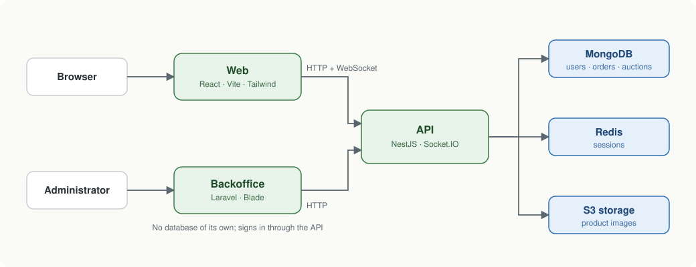
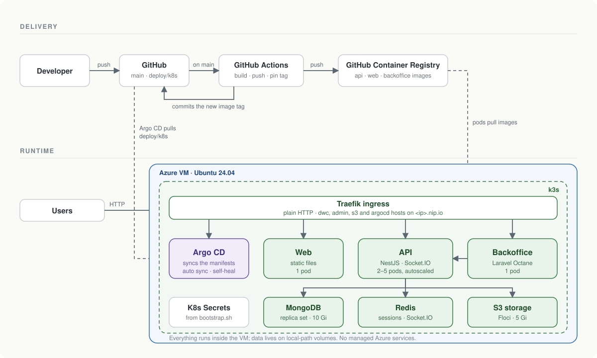

# Do Campo à Mesa

A marketplace for local producers: buyers browse and order farm products and bid
in live auctions, producers manage products, orders and auctions, and
administrators moderate through a separate backoffice.

## Deployed (while VM is live)

| App        | URL                                |
| ---------- | ---------------------------------- |
| Shop       | http://dwc.68.221.175.67.nip.io    |
| Backoffice | http://admin.68.221.175.67.nip.io  |
| Argo CD    | http://argocd.68.221.175.67.nip.io |

**Backoffice administrator:** `admin@68.221.175.67.nip.io` / `9a1d16be2683829454e9a307`

**Demo accounts** (shop sign-in, all share the password `DwcDemo-bab89222a85ca26b1f90347f`):

| Email                                      | Account                              |
| ------------------------------------------ | ------------------------------------ |
| `buyer.one@demo.dwclocal.invalid`          | Alex Buyer, buyer                    |
| `buyer.two@demo.dwclocal.invalid`          | Morgan Buyer, buyer                  |
| `producer.approved@demo.dwclocal.invalid`  | Demo Orchard, active producer        |
| `producer.pending@demo.dwclocal.invalid`   | producer awaiting review             |
| `producer.rejected@demo.dwclocal.invalid`  | producer with a rejected application |
| `producer.suspended@demo.dwclocal.invalid` | suspended producer                   |

## Tech stack

| Part       | Technology                               | Key libraries                                                                                  |
| ---------- | ---------------------------------------- | ---------------------------------------------------------------------------------------------- |
| Web        | React 19, React Compiler, Vite, Tailwind | TanStack Router, Query and Form, shadcn/ui (Radix), Lucide, socket.io-client                   |
| API        | NestJS, TypeScript                       | Mongoose, Socket.IO with Redis adapter, class-validator, jose (JWT), bcryptjs, Swagger, PDFKit |
| Backoffice | Laravel 13, PHP 8.4, Blade, Octane       | Alpine.js, Tailwind, BlatUI, Blade Lucide icons                                                |
| Database   | MongoDB (single-node replica set)        | Mongoose, transactions for checkout and orders                                                 |
| Sessions   | Redis                                    | node-redis; refresh sessions, revocation, Socket.IO pub/sub                                    |
| Storage    | Floci, an S3 emulator (images)           | AWS SDK S3 client                                                                              |

Tooling: pnpm workspaces, strict TypeScript, ESLint, Prettier, Docker Compose,
GitHub Actions, k3s, Argo CD.

## Architecture

### Application



Laravel has no database of its own: it signs in through the API and keeps the
tokens server-side. Details in [docs/architecture.md](docs/architecture.md).

### Deployment: Azure VM, k3s and Argo CD

The live demo runs on a single Azure Ubuntu VM, with no managed Azure services.
`deploy/azure/bootstrap.sh` installs k3s and Argo CD, generates the secrets and
creates the Argo CD application.



- **Seed data:** a post-sync job loads the demo data and leaves existing data alone.

## How to run locally

Only Docker with Compose v2 is needed.

```sh
docker compose --profile app up -d --build
```

The first start takes a few minutes: it creates the ignored `.env` files, builds
the images, installs the dependencies and loads the demo data. Then open:

| Service    | URL                            |
| ---------- | ------------------------------ |
| Web        | http://localhost:5173          |
| API docs   | http://localhost:3000/api-docs |
| Backoffice | http://localhost:8080          |

Local runs have no Kubernetes or Argo CD; those exist only on the Azure
deployment.

Stop everything (data is kept) with:

```sh
docker compose --profile app down
```

### Default accounts

| App        | Email                                      | Password             | Account                              |
| ---------- | ------------------------------------------ | -------------------- | ------------------------------------ |
| Backoffice | `admin@admin.com`                          | `admin`              | administrator                        |
| Shop       | `buyer.one@demo.dwclocal.invalid`          | `DwcDemo-Local-2026` | Alex Buyer, buyer                    |
| Shop       | `buyer.two@demo.dwclocal.invalid`          | `DwcDemo-Local-2026` | Morgan Buyer, buyer                  |
| Shop       | `producer.approved@demo.dwclocal.invalid`  | `DwcDemo-Local-2026` | Demo Orchard, active producer        |
| Shop       | `producer.pending@demo.dwclocal.invalid`   | `DwcDemo-Local-2026` | producer awaiting review             |
| Shop       | `producer.rejected@demo.dwclocal.invalid`  | `DwcDemo-Local-2026` | producer with a rejected application |
| Shop       | `producer.suspended@demo.dwclocal.invalid` | `DwcDemo-Local-2026` | suspended producer                   |

The demo data is loaded automatically on start if it is not there yet. Change the
shop password with `FIXTURE_PASSWORD` before the first start.

### Without Docker for the apps

Requires Node.js 24 LTS and pnpm 11.25.0. Only the infrastructure runs in Docker.

```sh
pnpm install --frozen-lockfile
pnpm setup:local   # creates an ignored .env with random local secrets
pnpm infra:up      # MongoDB, Redis, S3 and the image bucket
```

This route does not load the demo data by itself. Load it once, before starting
the API (the loader refuses to run while the API is up):

```sh
pnpm seed          # demo data; same accounts and password as above
pnpm dev           # web and API
```

The accounts are the same as in the table above. The backoffice runs with `pnpm backoffice:setup` once, then `pnpm backoffice:dev`.

## Docs

[Scope](docs/project-scope.md) · [Architecture](docs/architecture.md) ·
[Product decisions](docs/product-decisions.md) · [Roadmap](docs/feature-roadmap.md) ·
[UI guidelines](docs/ui-guidelines.md) · [Demos](demos/README.md)
